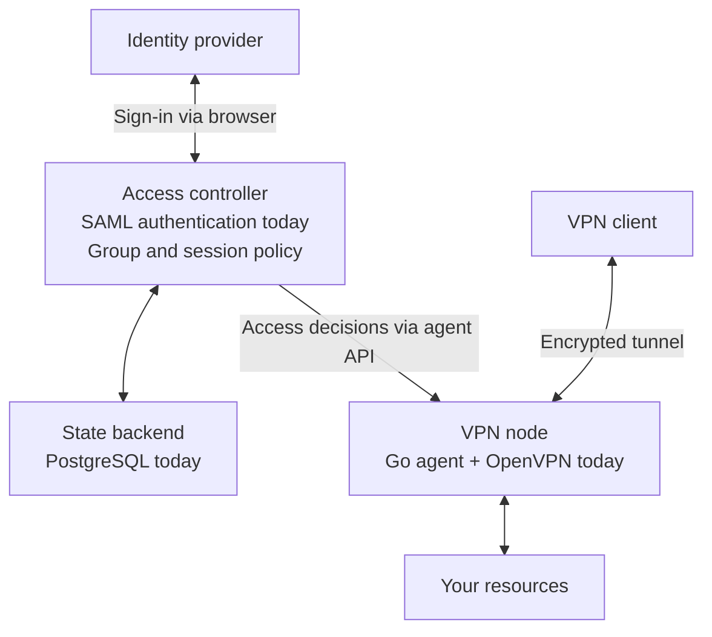

# SupiVPN

**Go Supi!** 
Your team. Your tunnel. Your rules.

Open-source SAML single sign-on and access control for OpenVPN Community.

[Website](https://supivpn.com/) · [Architecture](docs/ARCHITECTURE.md) ·
[Deployment](DEPLOYMENT.md) ·
[Releases](https://github.com/SupiVPN/supivpn/releases) · [Contributing](CONTRIBUTING.md)

Copyright (c) 2026 Stanislav Kazachkov (SupiVPN).
Licensed under [AGPL-3.0-only](LICENSE). Copyright ownership: [COPYRIGHT.md](COPYRIGHT.md).

SupiVPN combines a separate OpenVPN Community 2.7.8 process, a Go agent, and
a SAML authorization controller. Client profiles include `tls-crypt-v2`;
no client certificate is required. A verified SAML assertion determines access
and group membership.

The controller runs as an HTTP service on a VM or behind AWS API Gateway and
Lambda. Both modes use PostgreSQL 18 and the same authorization logic.
AWS adapters are isolated from SAML, IP allocation, and profile issuance.

## Architecture at a glance

Work identity answers **who you are**. SupiVPN decides **what you can access**.
The VPN transport carries **your traffic**. Keeping these responsibilities
separate is the starting point for adding more integrations over time.

This is a logical overview: the controller and state backend do not forward
VPN traffic. The Go agent applies access decisions and manages local IP leases;
OpenVPN handles the tunnel and traffic forwarding.

| Boundary | Available today | Direction |
| --- | --- | --- |
| Identity provider | Standard SAML IdPs; Okta is the documented setup example | More provider setup guides and interoperability coverage |
| Authentication | SAML verification and signed group membership | Additional authentication protocols behind a common access-policy model |
| State backend | PostgreSQL for shared login, decision, replay and session state | Additional storage implementations with the same consistency guarantees |
| VPN transport | A separate OpenVPN process controlled by the Go agent | Keep transport separate from identity and access policy |

Additional authentication protocols and shared storage backends are planned.
The controller already has an internal `Backend` interface for login state and
decision transitions, but runtime wiring and parts of the contracts still
depend on PostgreSQL and SAML. New adapters require implementation and security
testing before they can be selected in configuration.

See the [detailed architecture](docs/ARCHITECTURE.md) for deployment modes,
state ownership and trust boundaries, and [IdP configuration](docs/IDENTITY_PROVIDER.md)
for the current SAML integration requirements.

## Features

- SP-initiated SAML login from an existing OpenVPN client and browser profile downloads.
- Assertion-based groups, explicit priorities, and one or more IP pools per group and node.
- Active-active nodes with separate address pools and a shared `tls-crypt-v2` wrapping key.
- Reconnection after node failure with a new SAML login and IP; existing TCP sessions are lost.
- Group limits on session count and duration; expiry disconnects the tunnel and requires a new SAML login.
  Explicit unlimited mode and its risks are documented in [SESSIONS.md](docs/SESSIONS.md).
- Shared PostgreSQL state, replay protection, separate migrations, and database reconnection.
- Structured JSON events with configurable file/stream output and bounded local rotation:
  [logging and collection](docs/LOGGING.md).
- Routing to private resources while preserving group IP addresses. The deployment
  configures full tunnel routing, NAT, DNS, return routes, and network rules.

## Structure

SupiVPN is a single Go module rooted at `go.mod`. All commands are under
`cmd/`; implementation packages are private to this module under `internal/`.
Run Go and Make commands from the repository root.

| Directory / file | Purpose |
| --- | --- |
| `cmd/supivpn/` | Thin VPN agent entry point |
| `cmd/supivpn-*/` | Controller, Lambda, migration, profile and packaging commands |
| `internal/agent/` | Agent logic and its colocated unit/integration tests |
| `internal/controller/`, `internal/saml/` | Authorization and SAML verification |
| `internal/postgres/` | Database access and embedded, immutable SQL migrations |
| Other `internal/` packages | Transport and platform adapters, profile issuance |
| `examples/` | Public configuration and client profile templates |
| `testdata/` | Container definitions for independent interoperability tests |
| `docs/` | Architecture, operations, security and release documentation |
| `ci/`, `tools/` | CI configuration and repository/release tooling |
| `local/`, `out/` | Caches, build and CI outputs |
| [CONTRIBUTING.md](CONTRIBUTING.md), [BUILD.md](BUILD.md) | Contributor setup and build/test commands |
| [DEPLOYMENT.md](DEPLOYMENT.md) | Debian installation through packages, systemd, SAML and a working tunnel |
| [DEVELOPERS.md](DEVELOPERS.md) | Maintainer and release-signing guide |

Start with [architecture](docs/ARCHITECTURE.md), [runtime commands](docs/RUNTIME.md),
[host requirements](docs/HOST.md), [controller](docs/CONTROLLER.md),
[database](docs/DATABASE.md), [security model](docs/SECURITY_MODEL.md), or
[release delivery](docs/RELEASES.md).

The layout follows Go's [server project guidance](https://go.dev/doc/modules/layout)
and [single-module repository guidance](https://go.dev/doc/modules/managing-source).
Tests live beside the packages they exercise. Embedded OpenVPN fixtures live in
`internal/agent/testdata/`.
The module has no `go.work` and no public library API.

Build components with Make or download a versioned release. See
[CONTRIBUTING.md](CONTRIBUTING.md) for local development and
[release delivery](docs/RELEASES.md) for artifact verification.

## Contributing

SupiVPN is being built in the open. Start evaluating it with the
[Debian deployment guide](DEPLOYMENT.md) and read the [current limitations](#current-limitations) of
the project. To follow development, use GitHub's **Watch > Custom > Releases**.
Share your team's access workflow or a feature idea in an
[issue](https://github.com/SupiVPN/supivpn/issues), or help improve the docs and tests.
Report suspected vulnerabilities privately through [SECURITY.md](SECURITY.md).

Start with [CONTRIBUTING.md](CONTRIBUTING.md). Code contributions need Go, Python,
Git, Make and a C compiler; `make setup` prepares local tools and `make test`
runs unit/race tests. Docker is needed only for integration suites. No cloud
account, real IdP or production credentials are required. Documentation changes
can be submitted directly as a pull request without installing the toolchain.

Pick a [good first issue](https://github.com/SupiVPN/supivpn/labels/good%20first%20issue)
or send a small fix. [BUILD.md](BUILD.md) lists the focused test commands;
hosted CI runs the full architecture matrix.

## Support development

You can support SupiVPN development and maintenance through
[GitHub Sponsors](https://github.com/sponsors/enotf).
Contributions are voluntary and do not include services, priority support,
or exclusive features.

## Deploying SupiVPN

Follow **[DEPLOYMENT.md](DEPLOYMENT.md)** for a fresh Debian 13 server:
install `supivpn-node`, `supivpn-controller` and the `supivpn` metapackage,
supply your hostname, certificate and IdP in one setup file, then run
`supivpn-setup init`. It generates matching configuration, keys and a restricted
local PostgreSQL 18 database with migrations. Review the proposed firewall,
start systemd services, download a profile and verify a tunnel. The guide includes
denial checks, reboot acceptance and maintenance; the
[manual reference](docs/DEPLOYMENT_MANUAL.md) covers individual setup steps and
private-network routing.
To move PostgreSQL off the VPN VM, use the
[external database guide](docs/REMOTE_DATABASE.md): private networking, verified
TLS and a controlled data cutover. Remote setup-helper support is available from
[v0.6.1](https://github.com/SupiVPN/supivpn/releases/tag/v0.6.1).

Before choosing the defaults, review the guide's
[configuration options](DEPLOYMENT.md#choose-your-access-policy): explicit group
priorities, per-group session/connection limits, multiple IP pools, resource ACLs,
full tunnel and DNS. [Paired policy examples](docs/GROUPS.md#selection-and-policy-example)
show how to customize the generated controller and agent configuration.

This is a **minimal evaluation deployment**: all components on one VM with a
private Unix socket. Production deployment documentation and IaC are next on the
roadmap, including an **HA active-active cluster**. Existing cluster capabilities
are described in [HA](docs/HA.md); the production guide and IaC are still planned.
Existing tunnels do not migrate between nodes: reconnecting to another node
requires fresh SAML authorization and **changes the VPN IP**; existing TCP/SSH
sessions are lost. Review the other [architecture limits](DEPLOYMENT.md#architecture-limits-to-plan-for)
when planning availability and access policy.

The guide adds the signed `apt.supivpn.com` source and installs with
`apt install supivpn`. Signed Debian delivery starts with
[v0.6.0](https://github.com/SupiVPN/supivpn/releases/tag/v0.6.0).
A local build and verified GitHub Release downloads
remain available as alternatives. VPN client DNS SAN verification is unfinished;
read the guide's evaluation scope and the [limitations below](#current-limitations).

[Debian packaging](docs/DEBIAN_PACKAGING.md) describes build internals and
automated VM acceptance. [Architecture](docs/ARCHITECTURE.md) covers the wider
design; [HA](docs/HA.md#checks) describes additional cluster checks.

## Current limitations

Production readiness is assessed against the [security model](docs/SECURITY_MODEL.md).
Open tasks include VPN server DNS SAN verification with OpenVPN Connect and an
independent audit of the custom SAML/XMLDSig implementation.
PostgreSQL `verify-full`, including a separate TLS server name for connection
aliases, is implemented but must be enabled explicitly; the default `require`
encrypts traffic without verifying server identity. See [database TLS](docs/DATABASE.md).

Bounded EC2 stop/start recovery is implemented. Automatic VM replacement, ASG,
and rolling updates belong to the infrastructure deployment, not this checkout.
Wrapping key rotation with overlap and individual profile revocation are not implemented.
Local tests do not guarantee the behavior of a specific load balancer, routing setup, or IdP.

Findings R1-R3 are fixed; maintenance and controlled recovery from blocked
are documented in [RECOVERY.md](docs/RECOVERY.md). Cloud acceptance tests and the
blockers in [SECURITY_MODEL.md](docs/SECURITY_MODEL.md) remain before production.

The current client template does not yet verify the VPN server name.
It checks the CA, validity period, and certificate purpose. Server name
verification must be added before production; `tls-crypt-v2` does not replace it.

## License and new files

Original SupiVPN materials use [AGPL-3.0-only](LICENSE).
Copyright remains with Stanislav Kazachkov; see [COPYRIGHT.md](COPYRIGHT.md).
OpenVPN, Go, and third-party dependencies retain their own licenses:
[THIRD_PARTY_NOTICES.md](THIRD_PARTY_NOTICES.md).

The product name is **SupiVPN**; technical identifiers use `supivpn`.
New original source files include copyright and
`Licensed under AGPL-3.0-only. See LICENSE and COPYRIGHT.md.`
SPDX: `AGPL-3.0-only`.
COPYRIGHT.md defines the scope of the license. Retain third-party notices.

## Repository language

Write all documentation, comments, and repository text in English.
Do not include literal Cyrillic or Han characters in repository files or filenames.
Unicode test inputs must use language-appropriate escapes without changing
the values exercised at runtime.
