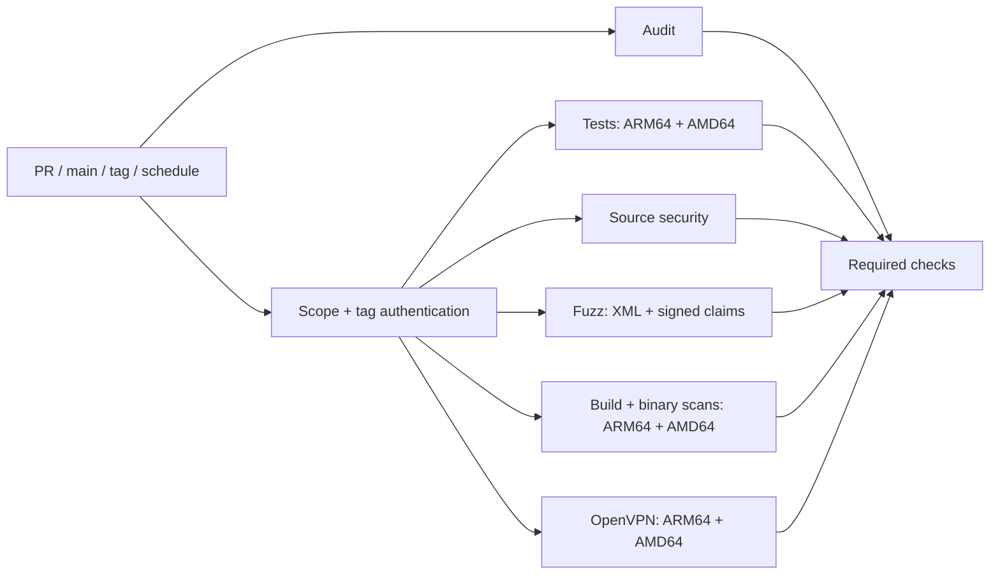

# Continuous integration

[Checks](../.github/workflows/checks.yml) runs on pull requests targeting main,
pushes to main or version tags, a weekly schedule, and manual requests.
Working-branch pushes do not start a duplicate pipeline.

A short scope job determines whether executable checks are needed. It also
authenticates signed version tags before release checks start. The audit job
runs independently. Documentation-only pull requests may skip executable jobs.
Changes to licensing, dependencies, workflows, examples or implementation
require the full checks. Main, tag, scheduled and manual runs always run them.

## Parallel jobs

| Job | Native architecture | Checks |
| --- | --- | --- |
| Audit | ARM64 | Source patterns, language, release notes, Python tooling and signing regressions |
| Tests | ARM64 and AMD64 | Combined unit/race, PostgreSQL 18 and XMLSec tests, integration-tag coverage |
| Security | ARM64 | Go vet, module integrity, source vulnerability checks for both deployment targets |
| Fuzz | ARM64, one job per target | XML/C14N and signed SAML mutations |
| Build | ARM64 and AMD64 | Binaries, Lambda ZIPs and binary vulnerability scans |
| OpenVPN | ARM64 and AMD64 | Real OpenVPN 2.7.8 authentication, rejection, expiry and failover |

Executable jobs depend only on the short scope job, so an image build, fuzz run
or database test does not hold up unrelated work. Both matrix legs run even if
one fails. Each OpenVPN job builds its test agent from the same commit and build
flags in its own workspace. Weekly runs check dependency freshness and increase
the fuzz budget rather than repeating the short fuzz run first.

Use `Required checks` as the branch-protection status. Its always-running gate
requires every applicable job to succeed; cancellation, failure or an unexpected
skip cannot produce a green check. A candidate archive uploaded by Build alone
is not sufficient for publication.

Dependencies and build caches are separated by architecture and workload, with
shared fallback for the same module checksums. Actions are pinned by commit.
Checks have read-only repository permissions and receive no release secrets.
Do not execute contributor code through `pull_request_target`.

PostgreSQL is disposable and listens only on loopback. OpenVPN containers have
a TUN device and no network access. Test images use pinned base digests and a
checksum-verified OpenVPN source archive. No workflow pushes container images
or requires a self-hosted runner.

## Tag builds and publication

A version-tag push authenticates the signed annotated tag and checks that its
commit belongs to main. It then tests and builds that exact commit. Each native
Build job uploads a candidate recording the version, tag object, source SHA,
architecture, workflow run and attempt, and archive checksum. The ARM64 job also
creates Corresponding Source with vendored Go dependencies and toolchain notices.
Candidates are retained for seven days; PR and main runs do not upload them.

The [Release workflow](../.github/workflows/release.yml) is manually dispatched
from protected main with an existing version tag. Preparation authenticates the
tag again using the current and target signer policies. It accepts only a
completely successful canonical tag Checks run with matching artifact provenance.
The versioned archives are validated and published unchanged, without rebuilding,
repackaging or substituting a main build.

Only the environment-approved sign job receives the dedicated artifact-signing
subkey, with read-only repository permissions. The separate publish job receives
no signing secret; it verifies the checksum signature before using repository
write permission. Tests and tag builds cannot access the signing environment.

If candidates expired, rerun all jobs of the original tag push run, then retry
release preparation. Partial reruns cannot mix candidates from different attempts.
Manual Checks runs do not produce candidates. See [release delivery](../docs/RELEASES.md)
for signing, approval and publication retry instructions.

Public standard hosted runner compute is free under GitHub's current plan;
cache and artifact retention still consume storage allowances. Parallel jobs
reduce elapsed time but do not promise lower total compute or eliminate queue
delays. See [GitHub billing documentation](https://docs.github.com/en/billing/concepts/product-billing/github-actions).
