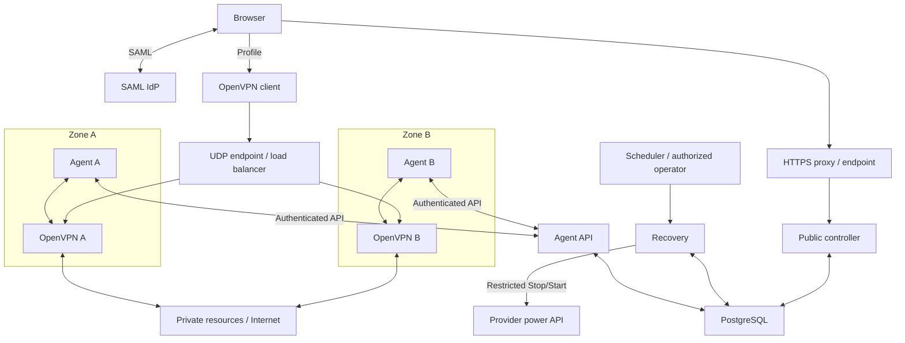

# SupiVPN architecture

Copyright (c) 2026 Stanislav Kazachkov (SupiVPN).
See [LICENSE](../LICENSE) for copyright ownership and licensing terms.

SupiVPN consists of VPN nodes, an authorization controller, and PostgreSQL.
SAML logic, group selection, and profile format are shared by VM and AWS Lambda
deployments. Infrastructure defines endpoints, networks, secrets, and process startup.

## Components

| Component | Responsibility |
| --- | --- |
| OpenVPN Community 2.7.8 | TLS, tunnels, and traffic forwarding |
| Go agent | Management protocol, browser auth, decision application, local IP leases |
| Public controller | SAML verification, group policy, one-time decisions, profile download |
| Agent API | Authenticated node registration, decisions, ACK/cancel and heartbeat |
| Recovery | Independent fencing, bounded autoheal, cleanup and operator commands |
| PostgreSQL 18 | SAML requests, decisions, node generations/leases, user slots, replay, profile logins, fencing/recovery state |
| SAML IdP | User identity and signed group membership |
| Infrastructure | VMs, load balancers, firewall, DNS, routes, TLS/secret delivery |

Existing OpenVPN clients with browser authentication support are used.
OpenVPN runs as a separate process; the agent uses its management Unix socket
and `learn-address` rather than embedding the daemon.

## One controller, two deployment modes

| | VM | AWS |
| --- | --- | --- |
| Entry point | `supivpn-controller` | Separate public, agent and recovery Lambdas |
| HTTPS | Go HTTP server; optional external proxy/LB | API Gateway -> Lambda |
| Agent authentication | Unix socket and peer UID check | AWS_IAM, SigV4, exact STS principal |
| Storage | PostgreSQL | PostgreSQL, including RDS |
| Secrets | Operator-managed files/environment | IAM and Secrets Manager adapter |

In VM mode, the controller can run beside the agent and OpenVPN as a separate
process. Other clouds require their own deployment; this checkout does not
provide provisioning for every provider.

AWS uses [separate IAM/database roles and concurrency](LAMBDA_ISOLATION.md)
for public, agent and recovery. VM mode combines these logical components in
one process and does not provide the same privilege boundary.
An AWS deployment can use NLB, private EC2, API Gateway/Lambda, and RDS.
An HTTP reverse proxy such as Cloudflare handles SAML/profile endpoints,
while UDP VPN traffic uses a separate path. A proxy does not replace origin
protection, API protection, or spending limits.

## State and authorization

SAML login is SP-initiated. The controller verifies the signature, InResponseTo,
audience, validity periods, browser binding, and groups. Full assertions, cookies,
and bearer tickets are not retained as logs; state uses hashes and internal bindings.

Every VPN decision is bound to a node ID, agent generation, CID, and KID.
An agent can Fetch the same decision again before ACK, but applies it only to
the matching live connection. ACK reflects the management API result.
HTTP 202 after SAML does not mean the VPN tunnel is ready.

Controllers share PostgreSQL, allowing another replica to handle the callback.
Every state use checks expiry; batch cleanup does not determine authorization lifetime.

The IP allocator and management connection are node-local.
The database does not store global IP leases.
Deployment tooling supplies consistent group configuration and disjoint
`group x node` pools. Configuration changes do not automatically orchestrate nodes.

## Groups, networking, and HA

The controller selects one highest-priority group: the lowest number wins.
Permissions from multiple groups are not combined.
The agent assigns an address from that group's local CIDRs; all pools full means rejection.

Private traffic preserves the group source IP for resource access rules.
Return routes direct each node CIDR to its node.
Full tunnel routing requires separate route pushes, forwarding, NAT, and DNS
in deployment. See [node requirements](HOST.md) and
[HA and pool expansion](HA.md).

After failure, clients automatically reconnect through the shared endpoint,
repeat SAML, and receive another node's IP. Existing TCP sessions are lost.
Test PostgreSQL HA, load balancer health checks, and each zone's egress separately.
After an ambiguous disconnect, cluster slots wait for proof that the old tunnel
has ended. The AWS adapter supports bounded stop/start recovery, separately from
load balancing and automatic VM replacement.
See [sessions and fencing](SESSIONS.md) and
[maintenance and operator actions](RECOVERY.md).

## Keys and profiles

Login flow: `tls-crypt-v2 -> TLS without client cert -> SAML`.
The client key only admits the client to TLS/SAML; it identifies neither the user
nor the group. All nodes share one wrapping key. It stays outside client profiles
and must survive routine VM replacement.

A SAML tile POST to `<public_url>/saml/launch` discards the unsolicited response
and redirects to `<public_url>/profile`, which starts a new browser-bound SAML
request. Direct links and existing Bookmarks still work. After authorization,
the controller returns a complete profile as an attachment. The real ACS rejects
IdP-initiated callbacks without an initial request; launch grants no access.
See [profiles](PROFILES.md) and [tls-crypt-v2](TLS_CRYPT_V2.md).

TLS certificates have an independent lifecycle; deployment defines delivery and
service restart after renewal. The current client template does not yet verify
the VPN server name; resolve this limitation before production.

## Implementation boundaries

VM/Lambda entry points, PostgreSQL backend and migrations, group multi-CIDR pools,
profile download, and locally tested inter-node reconnection are implemented.
Documentation describes application capabilities, not the state of any live environment.

Deployment tooling outside this checkout performs rolling updates and VM replacement;
the durable maintenance protocol coordinates them with runtime recovery.
The recovery operator protocol uses privileged direct Lambda invocation and has
no public or agent HTTP routes. A separate manual user disconnect uses the private
agent Unix socket on every node without Lambda:
[contract and limitations](REVOCATION.md).
Wrapping key rotation with overlap, individual profile revocation, and ready-made
cross-cloud provisioning remain separate work.
