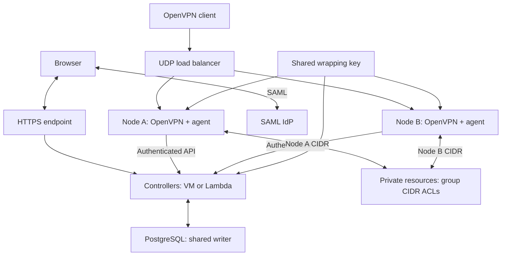

# SupiVPN active-active cluster

Copyright (c) 2026 Stanislav Kazachkov (SupiVPN).
See [LICENSE](../LICENSE) for copyright ownership and licensing terms.

Nodes accept VPN connections through a shared UDP endpoint. Controllers use
PostgreSQL for SAML requests, decisions, and replay protection.
OpenVPN sessions and IP leases remain local to each node.

Cloud load balancing, subnet layout, routes, and key delivery are deployment
responsibilities. AWS NLB/EC2/RDS is one option; runtime does not discover
accounts, zones, or route tables itself.

## Node count and group expansion

Calculate addressing before starting agents. For N nodes and desired reserve R,
the slot count is `2 ^ ceil(log2(max(N, R)))`.
Split every parent group CIDR into that many equal subnets.
Use the first N slots and retain the rest as spare capacity.

| Nodes | Slots without extra reserve | /24 partition |
| --- | --- | --- |
| 2 | 2 | Two /25 subnets |
| 3 | 4 | Three /26 subnets and one spare /26 |
| 4 | 4 | Four /26 subnets |
| 5-8 | 8 | /27 per node; unused slots are reserved |

Reserve four slots initially for future growth from two to four nodes:
existing /26 subnets remain stable within that reserve.
Without a reserve, expanding from two to three nodes resizes existing subnets.
Reducing the node count must not silently change addressing either.

Illustrative example for two nodes:

| Group | Priority | Parent CIDR | Node A | Node B |
| --- | --- | --- | --- | --- |
| operations-vpn | 10 | 10.200.0.0/24 | 10.200.0.0/25 | 10.200.0.128/25 |
| engineering-vpn | 20 | 10.200.1.0/24 | 10.200.1.0/25 | 10.200.1.128/25 |

Expand a group with another parent CIDR partitioned by the same scheme.
Each agent receives the calculated `group_pools[].cidrs` for its node.
It tries pools in list order and rejects allocation when all are full.
Address exhaustion never moves a user to a lower-priority group.

Runtime also accepts the legacy singular `cidr` field, mutually exclusive with
`cidrs`. Network/broadcast addresses and the TUN gateway are never assigned.
Equal CIDR sizes do not necessarily provide equal usable capacity:
the slot containing the gateway reserves one additional address.

Deployment verifies:

- No overlaps between any groups/nodes, private destinations, or environment networks.
- Pools fit inside the configured TUN network and each subnet is large enough.
- Stable ordering of node slots and parent CIDRs.
- Enough available zones and subnets for the requested node count.
- Load balancing, routing, and egress coverage for every zone.

The agent neither creates VMs nor discovers available AZs.
One-node-per-AZ placement and zone availability checks belong to infrastructure tooling.

## Return routes

Within the VPN network, route every node CIDR to the corresponding node interface.
Connected networks may send an aggregate route through a transit router to the
VPN network. Check both directions and preserve group IPs wherever access
depends on them.

In AWS, this can be node CIDR -> ENI and aggregate -> Transit Gateway.
Other platforms use their own routes/next hops.
Route count grows with route tables, nodes, and group CIDRs; check quotas.

Configure Internet SNAT separately. Full tunnel routing and DNS are described in
[node requirements](HOST.md#full-tunnel).
If clients use the tunnel gateway for DNS, the forwarder must be ready on every node.

## Failure behavior

The load balancer checks node readiness. After tunnel loss, the client reconnects
to the same endpoint. Another node performs a new SAML login and assigns an IP
from its own pool. Existing SSH/TCP sessions are lost.
No manual profile switch is required when endpoint, TLS trust, and wrapping key agree.

The load balancer does not transfer OpenVPN state or leases between nodes.
The old pool's return route is not transferred either; the new IP has its own route.
Recovery time depends on keepalive, health checks, UDP flow tracking, and the IdP.
An occupied cluster slot is not freed solely because its lease/session times out:
confirmed disconnect, a clean new generation, or fencing is required.
EC2 stop/start recovery can add minutes or enter blocked.
See [docs/RECOVERY.md](RECOVERY.md) and residual risks in
[docs/SECURITY_REVIEW.md](SECURITY_REVIEW.md). A local test with short timers does not
establish a production RTO.

## State and isolation boundaries

- `node_id + generation + CID + KID` isolates pending requests and decisions.
- Node identity comes from verified transport; arbitrary JSON cannot override it.
- Agent generations, management sockets, and leases are not copied between nodes.
- The wrapping key is shared; losing or changing it requires profile reissuance.
- Connection limits and each group's capacity must tolerate node failure.
  UDP load balancing does not account for exhaustion of an individual group's pool.
- Automatic VM replacement and rolling updates belong to deployment, not SupiVPN runtime.

## Scaling

1. Prepare zones, subnets, the load balancer, egress, and new-node routes.
2. Calculate pools; check non-overlap and spare capacity.
3. If existing subnets change, stop issuing old leases before changing routes:
   an old address could move into another node's new slot.
4. Deliver configuration, the key, and node identity mappings; check readiness.
5. Allow new nodes to accept clients and verify routing and failover.

## Checks

See [GROUPS.md](GROUPS.md) for adding/removing groups across agent revisions,
local test coverage, and removal limitations.

- Login on each node: correct group and an IP from its local pool.
- Multiple groups: explicit priority wins; no permitted group means rejection.
- Additional CIDR: allocation continues in the next pool after the first fills.
- A previously issued profile works on all nodes and after VM replacement with the same key.
- Node failure: automatic reconnect, new SAML login, and another pool's IP.
- Private resources see the group IP; test allowed and denied ports.
- Full tunnel routing, DNS, controller HTTPS, and Internet access work after reconnect.
- PostgreSQL unavailability blocks new authorizations; recovery needs no controller restart.

Local Go/PG tests check node isolation and shared state.
The [native OpenVPN suite](../testdata/openvpn/README.md) checks a real tunnel
and reconnection between two daemons. Cloud load balancing, routes, the IdP,
and client UI require separate acceptance tests.
