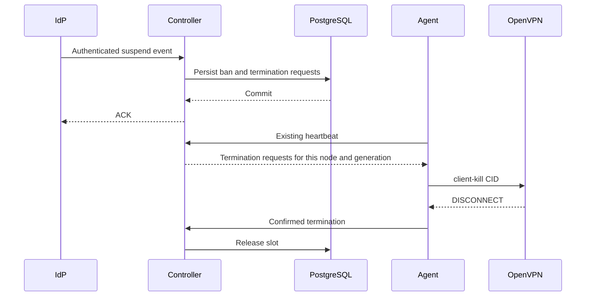

# Emergency access revocation

Copyright (c) 2026 Stanislav Kazachkov (SupiVPN).
See [LICENSE](../LICENSE) for copyright ownership and licensing terms.

**Automatic suspend/deactivate integration is deferred.** Runtime neither receives
these events nor checks current IdP user status. Heartbeat only extends the node
lease. Manual termination of current tunnels by username is implemented.

## Manual tunnel termination

The upcoming Debian [supivpn-cli](CLI.md) wraps this existing local operation
on combined node/controller hosts, including named migration listeners. It also
supports persistent profile blocking, which separately prevents new admission.

Username is the exact, case-sensitive SAML NameID. With Okta username prefix,
supply that prefix; do not convert email/displayName. Identity is scoped to the
issuer in metadata loaded by the agent at startup:
`SHA-256(issuer + NUL + NameID)`. The controller sends this existing database
hash to the authenticated agent with the decision. Since schema 8, plaintext
NameID is stored separately for tunnel logs, but is not the drop/limit key.

Each node has a private `operator.sock` beside its management socket:
directory 0700, socket 0600, peer UID checked against the process owner (root in
deployment). There is no public HTTP endpoint or new Lambda/IAM operation.
On a node:

```bash
printf '%s\n' '{"operation":"status","username":"alice"}' | sudo /opt/supivpn/supivpn --operator-request
printf '%s\n' '{"operation":"drop","username":"alice"}' | sudo /opt/supivpn/supivpn --operator-request
```

Use `--config` for a different configuration path. The command reads configuration
and contacts only the local socket; it does not read TLS private keys or credentials.
The deployment cluster script must contact **all** current nodes through SSH and
poll `status` after `drop` until `matched=0` and `unidentified=0`.
`requested/closing` confirms only a kill request, not tunnel closure.
Slots/IPs are released through normal `DISCONNECT → cancel`; the command never
changes database state directly. An unreachable node, unidentified legacy grants,
or timeout means an **unconfirmed result**.
If OpenVPN fails to confirm kill within 30 seconds, the existing guard stops the
node's entire agent/OpenVPN pair, potentially affecting other users.

This is a one-time drop, **not a ban on reconnecting**. For urgent revocation,
block IdP access first, then terminate tunnels.
Unauthenticated logins, decisions still in transit, and connections started after
the command are outside its snapshot; check these and rerun if needed.
Do not rename/reassign NameID before old sessions end.
Dropping the operator's own user requires independent SSH access, such as a bastion.

For the current runtime, apply [schema 8](POSTGRES.md), then update
**controller before agents**. Old agents do not request `include_subject` and
receive the previous decision format; new agents request the hash during Fetch.
Old controllers do not support this parameter.
Agent/controller metadata must identify the same IdP issuer.

Checks: `make test RUN=TestOperator`,
`make integration RUN=TestOperatorDropUserIntegration` (disposable PostgreSQL 18).
Coverage includes two nodes, other users, exact matching, repeated drop/CID reuse,
private sockets, malformed JSON, unknown hash, kill timeout, and slot retention
until DISCONNECT. These regression tests simulate OpenVPN management;
test live SSH/IdP after deployment.

## Deferred automation proposal

The rest of this document is a future proposal, **not approved for implementation**.
Timing figures are design targets, not deployment guarantees.

## IdP signal

For Okta, the primary signal is the `user.lifecycle.suspend` Event Hook;
also cover `user.lifecycle.deactivate` and `user.lifecycle.delete.initiated`.
These types support event hooks. Process successful events and identify the
affected user from the relevant `target`, not the administrator in `actor`.
[Okta event catalog](https://developer.okta.com/docs/reference/api/event-types/).

Hooks are asynchronous: duplication, reordering, and unbounded delivery delay
are possible; response timeout is 3 seconds with at most one retry.
A webhook alone cannot guarantee suspend-to-disconnect latency.
[Delivery contract](https://developer.okta.com/docs/concepts/event-hooks/).

To recover from lost events, consider checking **unique active users**, not
devices, through the IdP API once per minute. Bound worker calls per run; use a
persisted cursor, timeouts/backoff, and 429 handling. Do not fetch groups: SAML
remains the membership source. This fallback needs separate read-only access;
for Okta, a service app with `okta.users.read` and minimal administrative scope.
[Service app](https://developer.okta.com/docs/guides/implement-oauth-for-okta-serviceapp/main/).

Worker frequency is not full-scan duration. Measure each user's last-check age
and queue depth. If scale/quotas prevent checking everyone, do not claim one-minute
freshness. System Log polling may recover missed events, but an empty log page
does not confirm each user's current status.
[Polling/cursor rules](https://developer.okta.com/docs/reference/system-log-query/).

Strict mode could add a configurable freshness deadline: for example, 120 seconds
without confirmation for a particular user → terminate their sessions and reject
new ones until verification recovers. IdP API outage could then terminate many
tunnels; this is an explicit security/availability tradeoff.
The 120-second value needs approval and quota checks before implementation.
Absence of a suspend hook does not prove ACTIVE status.

Immediate response needs a separate privileged SupiVPN `revoke-user` command
persisting the same ban without waiting for the IdP. This is a future operator
API extension; existing recovery commands do not replace it.

## Identity binding

The current key hashes `issuer + NUL + NameID`; username prefix cannot reliably
map to an IdP user ID by truncating email/displayName.
Use a separately configured signed stable attribute such as `subject_id`.
For Okta: `user.getInternalProperty("id")`.
[Okta Expression Language](https://developer.okta.com/docs/reference/okta-expression-language/#okta-user-id-and-status).

Internal identity and limits should use issuer + subject_id, while NameID/username
remain display-friendly. Groups remain names. Revocation-enabled mode must require
exactly one nonempty scalar attribute in the verified assertion and reject ambiguity.
Identity migration requires terminating old sessions; otherwise one user can hold
two keys and bypass connection limits.

## Delivery to the tunnel



After committing the ban:

- Reject new grants/profile downloads regardless of stale SAML.
- Revoke pending grants too; revocation versioning must cover grants received
  by an agent but not yet applied.
- Request kill for **all** the person's sessions across every node/group.
- Existing 15-second heartbeat returns bounded command batches. A healthy system
  targets one heartbeat interval plus processing **after commit**, not 15 seconds
  after pressing Suspend in Okta.
- Receipt does not prove tunnel closure. Retain IP/slot until DISCONNECT/cancel
  or confirmed generation termination/fencing.
- Retries must be idempotent and bind node, generation, connection/decision ID.
  Never affect another user's reused CID.
- Do not extend leases indefinitely when mandatory revocations are ignored.
  Kill timeout closes the OpenVPN pair; existing fencing handles unhealthy/frozen
  VMs with witness, maintenance, and budget guards intact.

Unreachable VMs, blocked recovery, controller loss, or provider unavailability
prevent a guaranteed short disconnect time. Alert on `revocation pending`;
mark `completed` only after evidence that access ended.
Neither heartbeat expiry nor a sent Stop proves success.

The current heartbeat protocol carries no revocations. This needs a new database
schema, coordinated agent/controller API, and capability checks: old agents must
not be authorized to serve revocation-enabled sessions.

## Security boundaries

- Hook endpoint: HTTPS, separate authentication secret, constant-time verification,
  and rotation. Bind the secret to configured issuer/tenant; request bodies cannot
  select a different tenant.
- Bound body/batch sizes and validate JSON/event types; deduplicate by issuer +
  event UUID. Never log full events, credentials, or PII.
- ACK only after durable commit; no background goroutines after Lambda response.
  Commit failure returns 5xx, not false success.
- Cloudflare: no caching/browser challenge on the hook path; separate access/rate
  policy so client rate limits cannot discard suspend events.
- Serialize bans and admission under the same database subject lock/version:
  concurrent callbacks, old controllers, and rollback cannot bypass the ban.
- Unsuspend neither restores old tunnels nor revives grants. Initially, unbanning
  should require a separate operator CAS operation after checking current IdP
  state, followed only by a new SAML login.
- IdP adapters only deliver revocation to the portable core. EC2 fencing stays a
  provider adapter; clients never receive Okta/AWS keys.

## Tests before deployment implementation

Add unit/integration tests for all devices on two nodes; duplicate/reordered/lost
hooks; callback/Fetch/ACK racing revoke; missing/forged subject_id; username changes;
foreign issuer events; CID reuse; kill timeout/fencing; revocation backlog;
IdP 429/outage; old agent/controller; rollback; and unsuspend without grant revival.

Existing `TestGroupLifecycleIntegration` checks group changes and **demonstrates**
the lack of immediate revocation. It does not test this future suspend protocol.
